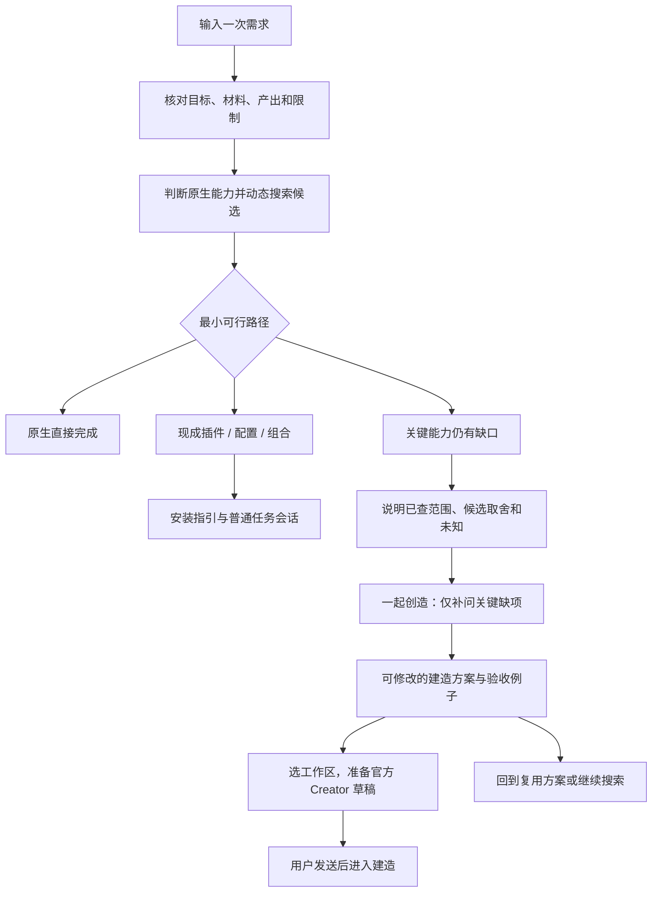

# 从发现好插件到一起创造好插件

2026-10-22（America/Mexico_City）｜本轮接手与设计草案，供讨论。尚未修改产品功能、安装新版本或发布。

## 产品决定

保留一个需求入口、一个任务及其版本历史。Finder 先帮助用户完成任务：原生能做就直接做，有现成插件就复用，需要配置、组合或少量改造就说明差额；确认关键缺口后，再一起设计插件。

**推荐采用：Finder 内完成渐进共创，交给官方 Creator 建造。** 官方已提供 Creator、开发 Skill 和模板，不重复建设底层代码生成器。Finder 的增量是把需求、发现证据、取舍、可编辑建造方案和验收例子连续带过去，让普通用户无需重新讲需求或先学 SDK。

其他两种方案的取舍：

| 方案 | 优点 | 代价 | 本次决定 |
| --- | --- | --- | --- |
| 只增加“去 Creator”与一段提示词 | 最快接通官方能力 | 尚未补齐需求和验收，容易变成通用教程 | 只作降级出口 |
| Finder 共创方案，再接官方 Creator | 复用官方开发能力，保持需求和方案连续 | 需新增共创状态、持久化与精确会话接续 | 推荐首版 |
| 新建完整独立 Builder | 可自行控制全部建造体验 | 重复官方能力，扩大代码运行、依赖、安装和维护范围 | 首版不采用 |

## 当前差距及基线

- 源码：`0.3.0-preview.2`，`main`，HEAD `ad0f09aea65ef6871789324d594b2d82f696d118`；接手时工作树干净，远端为 `oxmumu3/dsh-plugin-finder`。
- 本轮现有基线自动测试通过 259/259；这不是共创新功能、真实模型或宿主验收。
- 已有六字段需求理解、动态搜索、候选作者资料、native/single/combo/gap 方案、历史、反馈和普通会话草稿。
- 缺少：结构化候选取舍、共创澄清、可编辑建造方案、可复现验收例子、准确 Creator 会话绑定及建造状态。
- `history.validateWorkflow` 白名单只保留既定字段，不能仅在 UI 增加共创内容；否则恢复时会丢失。
- `package.json` author 仍为旧署名。后续新包按用户本次明确要求使用“奥克斯木木山”；正式 GitHub owner 仍为 `oxmumu3`。不改写已发布旧包或历史验收。

当前官方 Creator、两个版本的 API 差异与固定提交来源见[能力核查记录](../../research/2026-10-22-creator-capability-audit.md)。

## 用户路径

四条路径是对用户的解释，不强行扩展旧 `plan.kind`：

| 用户看到的判断 | 选择依据 | 接下来做什么 |
| --- | --- | --- |
| DSH 原生可以完成 | 已知实际工具/文本能力覆盖；未核实的文件或网络能力注明前提 | 直接准备执行任务草稿 |
| 有现成插件 | 作者资料支持主要能力，硬条件无已知冲突 | 给安装与首次使用步骤 |
| 配置、组合或轻改造即可 | 清楚指出复用什么、补什么；需要写代码就按改造建造处理 | 配置/组合走已有路径；改造进入共创并保留原插件版本及许可证待核项 |
| 需要一起创造 | 具体关键能力缺失、硬条件冲突，或用户明确选择定制；先排除一次性任务不必做插件的情况 | 说明定制理由，进入共创 |

全源失败显示“搜索未完成”，不生成“生态无供给”判断。部分失败、未检查候选、作者资料截断、免 Key 前提未知均保留。即使用户主动选择定制，也不能把它改写为已证实全市场没有供给。

## 首版交互

### 1. 从现有方案自然进入

在方案区增加“一起创造”分支，保留“调整需求继续找”。入口先显示具体缺口及本次证据，例如：

> 现有候选能做本地检索，但人工标注与原文件只读的组合还没确认。建议先继续核对；如果你希望定制使用方式，也可以主动选择“一起创造”。

这属于“适配性未知”，不标成已证实缺口。只有作者资料/已核事实明确不支持关键能力或违反硬条件时，才把具体缺口作为进入共创的理由。不能因为没有装过、用户未给路径、未实跑或目录查询返回零，就判定必须新开发。单插件/组合用户反馈不适合时，先记录具体不适合点；共创可以从该版本发起。

### 2. 渐进澄清，每次一个关键问题

自动继承已确认内容，只询问会改变建造方案的问题。每轮最多生成三个待澄清问题，逐个呈现，支持自然语言补充与“先按建议继续”。跳过的内容保存为假设，不能伪装成用户确认。

优先了解：这是否反复发生、完成的具体动作、材料/账号来源、读写边界、成功例子。每个问题都附本需求的具体例子，不让普通用户填写 SDK 表单。

例如资料库需求已经给出 Markdown 目录与本地约束，不再问“你想做什么”。可问：

> 你希望主要怎样使用它？
> - 在列表里筛选、标注，再点开原文（建议）。
> - 在会话里问一句，返回资料和原文位置。
> - 两者都要。

若只需处理一次材料，则提示可先用原生任务完成；仍允许用户明确选择将重复流程固化。

澄清改变输入输出、专用能力或硬条件时，旧搜索标注为“针对先前需求”。确认建造方案前重新判断复用路径，并在用户确认的新意图上重搜；若找到现成适配供给，允许直接转回。只改显示文案、名称或布局偏好不必重搜。

### 3. 边设计边理解 DSH 能力

用需求中的动作解释能力，技术细节放到可展开依据中：

| 用户动作 | 能力说明 | 必须说明的边界 |
| --- | --- | --- |
| 看列表、编辑标注、预览内容 | 插件可增加自己的导航入口与内容面板 | 不承诺接管整个 DSH 界面 |
| 在会话里使用专用能力 | 插件可注册工具，由 Agent 调用 | 工具可用性、调用确认和实际结果需验收 |
| 读取目录或连接服务 | Host 服务可访问文件、API 或本地服务 | “只读”需由实现和验收保障；界面复选框不产生操作系统沙箱 |
| 保存标签、配置、状态 | 可使用独立存储域，保留原文件 | 设计清楚保存位置、导出、删除与容量 |
| 调用 AI | 可沿用宿主已配置模型与账户路由 | 使用正常额度，第三方服务可能另有账号和费用 |
| 定时或后台执行 | 只有存在且核实了相应宿主服务时才加入 | 安装插件不自动证明常驻、休眠唤醒或定时可靠 |

不是每个插件都需要 UI、模型或联网；只选择完成本需求所必需的能力。

### 4. 可编辑建造方案

不只输出一篇教程。方案应包含以下可编辑内容，修改保存为同一任务的新版本：

1. 目标、使用者与最小使用流程。
2. 复用哪些现有能力；新建/改造什么；候选精确版本、未采用理由及未知项。
3. 输入、输出与一个具体示例。
4. UI 与会话工具分工；无需 UI 时明确使用会话即可。
5. 数据保存、文件读写、外部服务、账号/费用及权限边界。
6. 运行前提、宿主版本、维护与失败处理。
7. 最小首版范围、明确暂不覆盖的任务，以及可观察验收例子。

把“用户确认”“建议默认值”“待核实的依赖”分开标注。自然语言修改也可更新方案；不能自动删掉已有硬限制。信息仍不足时显示可讨论草案，允许保存、回看和继续补充。

共创提示给模型的 DSH 能力清单附核查版本与出处；模型不得凭空增加 SDK、已安装工具或后台服务。点击“开始共创”时进行一次有界模型调用；逐项填写时仅本机编辑，确认后再生成/更新方案，不随每次输入调用模型。

### 5. 接续官方 Creator

按钮文案为“准备 Creator 建造草稿”。用户选择工作区并检查建造内容，草稿包含原需求、已确认理解、搜索覆盖、候选取舍、建造方案、验收例子和待核实项。

当前官方 `0.2.1-rc.2` 可创建指定 Creator 预设的新会话。应新建精确会话，不复用原普通任务会话或现有空白草稿：

1. 写入前核对精确 task/revision，保存当前建造方案。
2. `ctx.sessions.create({workspaceId, agentPreset:'cordis'})`，不传已有 sessionId。
3. `retain` 并等待 ready，核对精确 binding 和 `agentPreset` 投影确为 `cordis`。
4. 调用该 binding 的 `requestDraftInitialization`，`clearPreviousDraft:false`。
5. 仅 `applied` 时打开会话，记录新的 Creator 会话关联；用户自行发送。

`preserved`、`blocked`、取消、绑定变化及保存失败均显示实际状态，不自动创建更多会话或重复注入。草稿已应用但关联保存失败时，只重试保存关联。下次“继续建造会话”只打开保存的精确会话，不重新调用模型或写草稿。

官方 create 没有请求幂等键，也不能假定取消 UI 即取消创建。创建前持久化 attempt（attemptId、来源 task/revision、建造内容 hash、workspace、creating 状态），保存失败不发起创建。返回的真实 sessionId 即使迟到，也由独立于当前页面选择的完成处理保存；页面取消后不自动注入或导航。相同 attempt 已有 sessionId 时只恢复该会话；仍在创建或结果不明时禁止再次 create。页面/进程在取得 ID 前崩溃的情况记为 indeterminate，提示核实后续恢复，不能声称 exactly-once，也不自动删除会话。

创建权由同一 Host 服务持有并串行领取，以 `(purpose, sourceTaskId, sourceRevisionId, contentHash, workspaceId)` 为唯一请求键。服务端检查并持久化后，只向一次调用返回 acquired；并发标签页/重复点击得到同一 existing attempt，不能发起 create。客户端不能任意换 attemptId 重新领取。服务重启后 creating/indeterminate 不自动释放创建权。迟到结果用 attempt 身份保存，不依赖当前活动指针；全局唯一性仅限该 Host/profile 的单服务所有者，实施时验证注册生命周期与并发请求，不能把普通先读后写当原子领取。

若 Client `SessionCreateError.rpcError.code` 为 `session/workspace-attach-failed`，提取并保存 `rpcError.details.sessionId`，显示“会话已创建，工作区关联未完成”。在核实归属前不注入草稿，不当作未创建重试；首版只提供打开该精确会话、显示目标工作区和复制建造方案的恢复入口，不保证宿主 UI 有重挂操作。首版不增加 Host 重挂 route；不得以再次 `sessions.create({sessionId,...})` 恢复挂接，因为这可能生成另一个 ID。[官方错误语义](https://github.com/deepseek-ai/deepseek-harness/blob/687f282e8625c6b8d11ff58211a90524be2e4317/packages/api/session-controller/src/commands.ts#L137-L146)

`0.2.0-rc.2` 不支持上述 `agentPreset` 创建参数；此版本保留发现功能，共创可保存/复制方案，提示手动选择 Creator。不能静默降成普通会话后宣称成功。

建造会话先核对官方开发 Skill、模板、实际工具与版本，再在所选工作区的独立子目录内创建首版。包创建、构建、测试、安装、运行、用户验收和公开发布各自记录。Finder 首版不自动发送、安装生成插件或上传私人内容；后续构建发生在用户发送后的 Creator 会话，并遵循宿主权限确认。

## 数据与实现切入

- 保留旧 `plan.kind` 与 `understand/plan` 工作流阶段，在 workflow 新增可选、受验证的 `creation` 对象；客户端用其子状态显示澄清/建造方案/接续。
- `creation` 至少记录：来源任务版本、触发理由、复用/改造/新建策略、搜索证据引用、候选取舍及依据、问题/回答/假设、建造方案、验收例子和精确 Creator 会话绑定。所有推断注明证据类型；不虚构未读取候选的排除原因。普通任务与 Creator 的 handoff 分别标明 purpose，Creator 关联固定来源 revision 与建造内容 hash，不能用“最后一条 handoff”混淆入口。
- 每次确认或保存追加同任务不可变版本；旧推荐、用户反馈和普通会话绑定保留。共创反馈只沿当前祖先链使用，不能串到兄弟方案。
- `contracts.js`、`history.validateWorkflow`、客户端恢复验证及备份导入导出同步支持新对象；旧备份仍可恢复，旧格式不伪造共创字段。包含共创的任务必须采用旧版不能误写的任务格式标记（如 task format 2），新版同时读取旧 format 1；不能保持旧标记而让旧客户端读写时静默丢掉新增内容。上线前单独验证备份、升级和误装旧包时的保护表现。
- 共创相关动作采用新 route 与 service 方法，并携带 taskId/revisionId；模型调用前及落盘前检查过期版本。模型输出只作数据解析，作者 README 不能成为执行指令。
- 既有安装/普通会话路径保持；Creator 创建单独函数，复用 binding、草稿结果和关联保存的保护，不改变普通接续的语义。
- 保留完整第三方精选源、用户已配置原生市场和 GitHub topic 的动态发现，含 GitHub-only 候选；不回退固定名单，不自动添加市场源，不把第三方目录标成官方审核。新增或变更官方来源时另核真实地址与 API，不能凭空补一个“官方市场”。
- 首版共创内容仅本机保存。现有回传同意不自动扩大到新增建造内容；不得将新字段塞进旧事件或方案摘要。共创起点之后的整个分支在事件创建入口禁用旧遥测，包括其 intent 修改、澄清答案、refinement/result feedback、plan_generated、plan_selected 与 Creator handoff；不能只删除 creation 字段，却由旧 intent/feedback 摘要间接上传。原复用分支的既定回传行为按原同意范围运行。新增回传范围需另行说明与明确同意。
- 沿用宿主默认模型，不收新 Key，不修改模型设置。共创会增加模型调用，应在触发前说明；无修改地回看历史不调用模型。

## 验收规格

| 层级 | 可证明什么 | 本轮状态 / 后续判据 |
| --- | --- | --- |
| 源码与官方能力核查 | 当前 API、Creator 和版本限制 | 本轮完成，只读；见核查记录 |
| 现有自动测试 | 旧行为基线 | 本轮 259/259；不算新增功能通过 |
| 生产发现模块公开检索 | 动态来源和作者资料可读 | 本轮两组通用合成需求实查，见 JSON；未调用宿主模型 |
| 新增自动回归 | 共创连续性、状态与失败保护 | 实现后运行，不继承旧测试结论 |
| 隔离安装 | 新包能安装、启用，数据兼容 | 实现后在独立 profile；核对包文件和历史备份 |
| 真实宿主与模型 | 现成匹配和共创接续两个路径 | 实现后逐条实跑；不把模拟 UI 当宿主验证 |
| 生成插件运行 | Creator 生成物可构建并完成验收例子 | 独立记录版本、测试输入输出、失败与恢复 |
| 用户首用 / 公开发布 | 用户接受 / 公开附件实际可下载 | 分开等待实际证据；本轮未发生 |

自动回归至少覆盖：

- 现成插件匹配保持 single/combo；一次性原生任务不诱导创建。
- 动态新增条目、GitHub-only、作者资料预算、源状态和记录数限制继续通过既有回归；索引总量不能在共创页改称可用插件总数。
- gap 或用户明确定制后进入共创，继承原需求、硬限制、精确候选版本、时间、覆盖与未知项；旧版不变。
- 全源失败不能产生“无供给”结论；部分失败、未知 Key 和未读候选不能变成负面功能断言。
- 澄清、手动编辑、取消、重载、导出/导入保留建造方案；新需求后仍可回看。
- 过期 task/revision 在模型调用和写入前拒绝；容量/存储失败不清屏、不裁剪历史。
- Creator 预设错误、旧宿主、会话创建结果延迟、取消与绑定切换不写入错误会话；重试不重复建会话。
- create 返回迟到、重载时 creating、结果不明及 workspace-attach-failed 含真实 sessionId，按 attempt 状态恢复，不自动重新 create；明确标示无法自动保证不重复的边界。
- 两个标签页同时为相同请求键领取创建权，只允许一个 acquired；重启不释放 creating/indeterminate；同一旧任务的普通接续不误用 Creator attempt。
- 既有草稿、附件、普通任务会话和反馈不受影响；关联保存失败只重试保存。
- 不同意时零回传；即使已同意旧摘要回传，共创答案、派生 intent、建造内容和结果反馈的独特哨兵文本也不能出现在任何新遥测队列或实际请求体中。
- 澄清改变硬条件或专用能力时，旧搜索标为旧意图并重新搜索；用户明确选择定制与有证据的能力缺口分开记录。
- 旧版遇到包含共创的 format 2 任务时应明确拒绝读取且保留原数据，不能展示为旧方案或写回删除共创字段；这是降级可用性限制，升级包说明需披露。

真实路径 A：用未含插件名的 Markdown 图表预览需求，从本轮真实来源匹配、读取作者资料，给出最小复用方案，核对指定工作区接续。

真实路径 B：先查真实来源和候选，再由证据支持关键缺口，或由用户明确选择定制；补齐关键问题，保存可编辑建造方案，创建且核对官方 Creator 会话，读回未发送草稿和所有原历史。若候选实际可满足，应转回复用；不能为了通过测试硬造缺口。

## 本轮公开检索对设计的影响

原始证据：`docs/research/2026-10-22-discovery-probe.json`。使用生产 `createDiscovery` 和公开合成输入，不接用户活跃 profile，不读取业务文件，不调用模型，不安装候选或创建会话。

- Markdown 预览需求发现 `dsh-md-studio@1.2.0` 等六个候选，取得作者清单和资料；部分候选 README 缺失或截断。匹配 1,246 条只表示宽召回，实际核对 6 条，不能称为 1,246 个适用插件。
- 本地 Markdown 资料库需求返回 `dsh-ai-library@0.3.39`、`dsh-knit@0.24.0`、`dsh-zotero@0.2.2`、`dsh-lost-and-found@0.1.5`。这要求继续核对复用价值；未读全部作者资料，不能直接判定要新建。
- 后者有 16 个候选的免额外 Key 前提未知、资料读取失败/超时及大量未核对候选。免 Key 未确认不等于一定需要 Key；这些不足必须带入共创判断。
- 本轮源返回的目录记录总量是索引规模；来源重叠、版本兼容与安装/功能仍待核对。宿主市场在此独立探针中为未配置，不代表用户原生市场状态。

## 开发顺序

1. 共创契约、来源引用、历史与备份兼容；先验证数据不会丢。
2. 服务端生成/更新澄清与建造方案，UI 提供逐步回答、编辑、保存和回看。
3. 单独接入 Creator 新会话、预设验证、错误与旧版降级；保留现成方案路径。
4. 补齐上述回归和隔离安装，独立审读；再实跑真实宿主两条路径与生成物验收。
5. 依据实际验收确定新 Preview 版本与说明；未经明确发布授权不公开生成的私人插件或需求。

当前这份设计与证据可讨论，尚未作为已实现/已验收的能力对外宣传。

## 2026-10-22 批准与实施状态补记

上文保留最初设计讨论时的原文。用户随后明确批准本设计，并要求直接实现和实跑；“供讨论”“尚未修改功能”等语句描述起草时状态，不再代表本轮授权状态。实施计划见[首版实施计划](../plans/2026-10-22-discover-to-create.md)。

本轮已实现后端共创契约、不可变历史、format 2 保护、分支遥测隔离、客户端共创流程及独立 Creator helper，并完成有针对性的自动回归和独立审读。审读中发现的题目/答案断点、祖先反馈遗漏、运行假设与 UI 变化漏重搜、attempt 容量保护和起点候选版本混淆，均已补回归后修正。这些完成状态属于源码和自动检查层级。

真实模型试跑中出现共创确认失败后，又补充了累计硬限制保护：累计最多 24 条，模型单次提取仍最多 6 条；超过 6 条的普通任务也升为 format 2，不改变其遥测范围。内部失败记录安全阶段，不公开模型原文；兼容缺少可选反馈字段的早期共创草案，不改变 contentHash 算法。

最终全套与候选包核验、真实共创确认复测、官方 Creator 草稿接续、生成物构建/运行、当前 Desktop 热更新及用户接受仍按各自证据判定，当前本补记均记为 pending，不以自动测试替代。最新验收表见[验证范围](../../verification.md)。私人需求或生成插件的公开发布授权不由本次实现批准推导。

### 实跑推进补记（2026-10-22，较上述 pending 检查点更新）

Finder 源码全套 332/332 和构建已通过，提交 `0cb1585` 包含恢复 A 后保留下一条 B 恢复入口的最终修复。真实实跑对应较早的 `47d43f7605a6082ec25fdf1dfd420fb6dcb2eaf76ac57866b16950451fed215c` 历史安装包：独立官方 Host/真实默认模型匹配 `dsh-md-studio@1.2.0`，原 clarify 共创任务确认到 ready（3 个回答、供给 current）；Desktop 已经原生热更新为 0.4.0-preview.1、enabled、1 running。更新前后两份历史 JSON 字节一致，两份旧草稿的完整存储值、草稿对象与内容一致；导入两个合成任务后旧两任务仍保留。这些匹配证据不包含本轮 `dsh-md-studio` 安装或渲染验收。

官方 Creator 已实际接续：精确 `cordis` 会话、唯一 applied attempt、32,495 字初始化草稿逐字读回；重复点击仅打开同一会话。草稿核验时 0 用户消息/0 turn，随后操作者另行追加合成实施范围并显式发送，两轮生成均 completed。普通任务路径单独记录 applied handoff，`standard` 预设、4,184 字草稿与生产 controller.prompt 逐字相同、0 用户消息/0 turn，仍未发送，没有使用 Creator attempt。

第二轮生成物 `dsh-reading-shelf-fixture@0.1.0` 已通过 35/35 测试及 check/build/pack，操作者审查后原生安装，显示 1 个组件运行中。使用手工绝对路径读取合成目录，`Fixture One / Agent / Reading` 保存、主题/状态筛选及清除筛选、63 B 原文的只读 Markdown 文本预览、Refresh 后重新读取持久化均通过。两个 Markdown 的哈希及 mtime 均与基线一致，421 B 独立 JSON 只保存元信息。Browse 点击未观察到可见 picker，目录选择器仍未验证；本轮合成样例不能代替重启恢复、长期稳定性或外部用户接受。

本补记为打包时状态，最终 Finder 重新打包及 Desktop 再次热更新待交付收尾。最终包校验值、安装读回与安全证据由 `Agent/output/dsh-plugin-finder-creator-2026-10-22/` 内 `acceptance-status.json`、`验收报告.md` 和 `evidence/` 记录；包内文档不写入自身哈希。精确 ID 及已观察边界见[验证范围](../../verification.md)，未公开发布。

### 交付收尾补记

最终本机包已原生热更新并启用，34/34 安装文件逐字节匹配；4 条任务、原两草稿完整存储值、普通未发送草稿及 Creator 已完成记录均保持。验收报告、校验值和安全证据已落盘；本轮隔离 Host 与临时凭据已清理，用户两个 Host 未重启。上文打包时的待收尾项已由交付目录 `acceptance-status.json` 和 `.agent/memory/progress.md` 的最终证据覆盖；Browse picker、长期使用与外部用户接受仍未验证，未公开发布。
